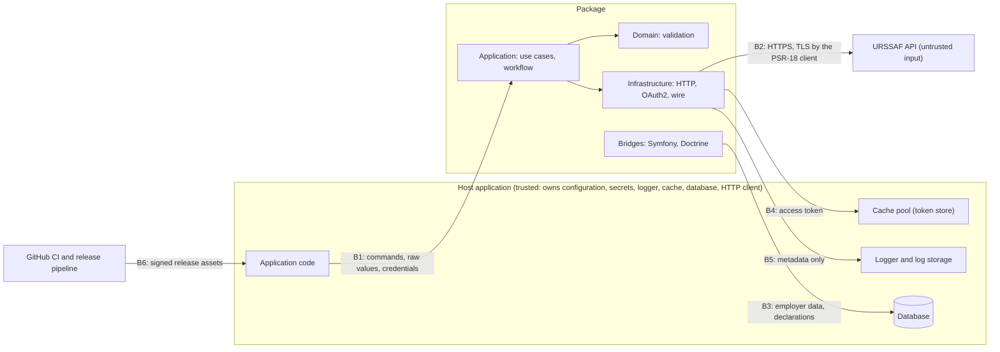

# Security assurance case

This document argues why the security requirements of `thebeardedbear/urssaf-tierce-declaration-paje` are met. It is
grounded in a review of the code at the commit named in the [security review](security-review-2026-11.md): each claim
points to the file that implements it, and the document states its limits. The package is a library, so part of the
security of a deployment belongs to the host application (see [Assumptions on the host](#7-assumptions-on-the-host-application)).

Reporting a vulnerability: [SECURITY.md](../../SECURITY.md).

## 1. What is protected

The package lets a third-party declarant platform, on behalf of private employers, verify Pajemploi accounts, associate
employees, register and cancel the platform's mandate, estimate contributions, and pre-declare and declare the salary of
a childminder (AMA) or a home childcare worker (GED) with the URSSAF "API Tierce Déclaration PAJE" (scope
`tiersdecl.paje`, OAuth2 client credentials). A declaration cannot be amended or read back, and a duplicate is rejected:
integrity and "exactly once" matter more here than anywhere else in the package.

| Asset | Where it lives | Sensitivity |
|---|---|---|
| OAuth2 `client_id` / `client_secret` of each tenant (a tenant is one set of credentials of a declarant platform) | Host configuration or `CredentialsProvider`; in memory in `Application\Port\Credentials` | Secret |
| Access token | `TokenStore` (PSR-6 / PSR-16 cache pool), in memory during a call | Secret, short lived |
| NIR (social security number) of employees, employee identity and address, child names and birth dates, child disability days | Value objects of `Domain\Employee`, `Domain\Child`, `Domain\Declaration`; sent to URSSAF; **never persisted** by the package (ADR 0007) | Personal data (GDPR), NIR, health data |
| Employer Pajemploi number and birth date, mandates, declaration records (period, amounts, withholding rate, `referenceDocumentaire`, URSSAF error codes and descriptions) | Host database (Doctrine bridge, tables `urssaf_paje_*`), sent to URSSAF | Personal data (GDPR), financial; integrity critical (declared salaries) |
| Integration events (outbox) | `urssaf_paje_outbox` table or in memory | Technical identifiers only, no personal data |
| Source code and releases | GitHub repository, Packagist, release assets | Integrity critical (supply chain) |

## 2. Security requirements

| ID | Requirement |
|---|---|
| SR1 | Credentials and tokens are never persisted by the package, never logged, never present in exception messages, and masked when dumped. |
| SR2 | Personal data (NIR, identities, birth dates, employer numbers, child data) is never logged by the package and never present in exception messages; what the package stores is minimal and erasable (GDPR). |
| SR3 | A salary is declared at most once: the amounts and periods sent to URSSAF are what the host asked for (validated, exact, no float drift) and a declaration whose outcome is unknown is never resent automatically. |
| SR4 | Everything received from URSSAF is untrusted: parsed strictly, never executed or deserialised into arbitrary objects, and a malformed response fails closed. |
| SR5 | Requests are authenticated and sent to the intended URSSAF host; one tenant can neither use nor see another tenant's credentials, tokens or records; a declaration is only sent for an employer whose mandate is held. |
| SR6 | A failure of URSSAF or of the network degrades gracefully: bounded retries on reads only, an explicit "may have reached URSSAF" signal for writes, no data loss, no unbounded loop. |
| SR7 | The code and the release artefacts come from the maintainers' reviewed and tested commits and can be verified by consumers. |

## 3. Threat model

| Actor | Capability considered | Main threats |
|---|---|---|
| Network attacker | Observes or tampers with traffic between the host and URSSAF | Eavesdropping on tokens, NIR or birth dates, response tampering, downgrade |
| Malicious or compromised URSSAF endpoint (or a proxy configured as such) | Returns arbitrary bodies, statuses and sizes | Injection through response fields, deserialisation, resource exhaustion, secrets or personal data in error text |
| Host application bug or misconfiguration | Controls configuration, logger, cache, database, listeners, HTTP client | Secrets in clear configuration, `http://` base URI, shared cache, verbose logs, URL logging by the HTTP client, no retention policy, automatic resend of a declaration |
| Other tenant of a multi-tenant host | Uses the same host application | Cross-tenant access to records, tokens or credentials |
| Hostile user-supplied data | Names, NIR, numbers, dates, amounts reach the package through the host | Malformed values reaching URSSAF or the database, a wrong salary declared |
| Concurrent workers and retries | Two processes, a cron racing a worker, a request that times out | Double declaration, a declaration lost or recorded twice |
| Malicious contributor, poisoned dependency, abused CI token | Pull request, dependency update, workflow permissions | Backdoor in the package, secret exfiltration from CI, tampered release |

Out of scope: compromise of the host server or the database server itself, and the security of the URSSAF platform
(see [SECURITY.md](../../SECURITY.md#scope)).

## 4. Trust boundaries

| Boundary | What crosses | Control in the package |
|---|---|---|
| B1 host to package | Commands and raw values (NIR, names, dates, amounts) | Value objects validate at construction (`src/Domain/**`: anchored regexes with the `D` modifier, length and range limits, amount bounds per field in `Shared/AmountRules`); the single-shot `Input` factories collect violations; credentials only through `CredentialsProvider` |
| B2 package to URSSAF | HTTPS requests with a bearer token; untrusted responses. The contract puts the employer number, the NIR and birth dates in the **query string** of operations 020, 021, 023, 030 and 031 | TLS and certificate verification are delegated to the PSR-18 client; strict JSON decoding and typed mapping (`Infrastructure/Urssaf/Wire`); the package never logs the URI, query or bodies and sanitises transport errors (ADR 0002, ADR 0007) |
| B3 package to database | Employer number and birth date, mandates, declaration records | Doctrine named parameters; no column for NIR, names, address or child data (`tests/Functional/Doctrine/Mapping/PersonalDataColumnsTest.php`); birth date in its own DBAL type that the host can replace to encrypt; `ForgetEmployer` erases an employer |
| B4 package to cache | Access token | Hashed cache key, item expires with the token (minus a safety margin), a malformed item is a cache miss |
| B5 package to logs | Technical metadata | Fixed set of fields: operation, method, path template, status, duration, request id, exception class |
| B6 pipeline to consumers | Releases | Pinned actions, least-privilege tokens, SLSA provenance, checksums |

Inside the package, Deptrac enforces the layers that separate these zones (`deptrac.yaml`).

## 5. Secure design principles

Saltzer and Schroeder principles mapped to the code.

| Principle | How it is applied | Where |
|---|---|---|
| Economy of mechanism | No third-party runtime code: `require` lists only PSR interfaces and PHP extensions. The HTTP client, cache, clock and logger come from the host. The JSON encoder is a small own class that refuses floats. | `composer.json`, `Infrastructure/Urssaf/Wire/JsonEncoder.php` |
| Fail-safe defaults | `environment` is mandatory (no implicit production). The simulated gateway cannot be combined with `environment: production`, at configuration time and at runtime. The default logger is a `NullLogger`. A malformed cached token is a cache miss. Operations 023, 030 and 031 (idempotency unspecified by URSSAF) are treated as never resent unless the host opts in. Erasing an employer with an active mandate or an unknown outcome is refused unless the host opts in. | `Bridge/Symfony/DependencyInjection/ConfigurationRules.php`, `SimulatedGatewayFactory.php`, `Infrastructure/TokenStore/CachedAccessToken.php`, `Application/Port/Operation.php`, `Application/Policy/WorkflowPolicy.php` |
| Complete mediation | Every URSSAF call goes through `JsonApiClient::send()` (rate limiter, bearer token, status mapping). Value objects have private constructors, so every instance went through validation. `DeclareSalary` and `PreDeclareSalary` check the mandate (`MandateGuard`, `MandateRequired`) before calling URSSAF. | `Infrastructure/Urssaf/Http/JsonApiClient.php`, `src/Domain/**`, `Application/Service/MandateGuard.php` |
| Open design | Open source, documented protocol mapping and decisions (ADRs), public quality thresholds. Nothing relies on secrecy of the code. | `README.md`, `docs/`, `docs/adr/`, `CONTRIBUTING.md` |
| Separation of privilege | Strict layers: Domain depends on nothing, Application on Domain and Contract, Infrastructure and bridges on the layers below. Integration events are separate scalar classes. | `deptrac.yaml`, `src/Contract/Event` |
| Least privilege | Credentials fetched per tenant on demand; a single OAuth2 scope (`tiersdecl.paje`); CI workflows default to `contents: read` and elevate per job. | `Application/Port/CredentialsProvider.php`, `Infrastructure/Urssaf/UrssafEndpoints.php`, `.github/workflows/*.yml` |
| Least common mechanism | Token cache key is `sha256(environment, base URI, client id)`; non-blocking locks per operation and scope; repositories filter on tenant id. | `Infrastructure/Urssaf/Http/OAuth2TokenProvider.php`, `Bridge/Symfony/Lock/OperationLocks.php`, `Bridge/Doctrine/Repository/*` |
| Psychological acceptability | The secure path is the default path: secrets through `%env()%`, one factory to build the gateway, a `urssaf:paje:check` installation diagnostic, a GDPR section with an encryption recipe. | `docs/symfony.md`, `docs/doctrine.md`, `Bridge/Symfony/Diagnostic/*` |
| Defence in depth | Secrets are masked in `__debugInfo()`, marked `#[SensitiveParameter]`, not serialisable, not logged, absent from exception messages. Value objects holding personal data (`Nir`, identities, children, birth dates) are masked in dumps and have no `__toString()`. | `Application/Port/Credentials.php`, `AccessToken.php`, `Domain/Employee/Nir.php`, ADR 0007 |
| Fail securely | HTTP errors become typed exceptions carrying the status and URSSAF error codes. An unexpected status or body raises `UnexpectedUrssafResponse` instead of being interpreted. Exactly one replay after a 401 (proof that the call was not processed), no other automatic retry in the client. | `Infrastructure/Urssaf/Http/JsonApiClient.php`, `Infrastructure/Urssaf/Exception/UnexpectedUrssafResponse.php` |
| Integrity by construction | Amounts are integer cents (`Amount`) encoded as exact decimal literals (`JsonDecimal`); floats are refused by the encoder. A declaration (050, 051) is never resent: a transport error, a 5xx other than 512, or an unreadable 2xx answer is an `OutcomeUnknown`, the local record moves to `outcome_unknown` and only an operator resolves it. A record is claimed atomically (`pending` to `submitting`) before the call, and an accepted answer is always recorded or raised as `DeclarationRecordingFailed`, never resent. | `Domain/Shared/Amount.php`, `Infrastructure/Urssaf/Wire/AmountEncoding.php`, `Application/Port/Operation.php`, `Application/Service/DeclarationSubmitter.php`, ADR 0003, ADR 0006 |

## 6. Common implementation weaknesses and how they are countered

| Weakness (OWASP Top 10 2021 / CWE) | Countermeasure | Where, verified by |
|---|---|---|
| SQL injection (A03, CWE-89) | DQL and DBAL with named parameters. The only interpolated identifier is the outbox table name read from Doctrine metadata, never request data. | `Bridge/Doctrine/Repository/*`; PHPStan Doctrine extension, review |
| HTTP, header and form injection (CWE-93, CWE-113) | Query and token body built with `http_build_query(..., PHP_QUERY_RFC3986)`; paths are constants and the employer number in the path is a validated value object; the user agent and optional header names are validated (no line break); header values come from configuration or generated ids. | `JsonApiClient::buildRequest()`, `OAuth2TokenProvider::fetch()`, `ApiConfiguration`, `HttpHeader` |
| JSON injection (CWE-116) | Every key and string goes through `json_encode` with `JSON_THROW_ON_ERROR`; only null, bool, int, string, arrays, `JsonDecimal` and `JsonObject` are accepted. | `Wire/JsonEncoder.php` |
| Sensitive data exposure (A02, CWE-200, CWE-532) | Logs hold operation, method, path template (the employer number is replaced by a placeholder), status, duration, request id and exception class; URIs, bodies, tokens and descriptions are never logged. A PSR-18 exception message (it embeds the URI, hence the query string with NIR and birth dates) is dropped: only its class is kept. JSON exceptions are not chained (their trace would hold the body). Debug output is masked. | `JsonApiClient`, `TransportError`, `OAuth2TokenProvider`, `Wire/JsonDecoder.php`, `Application/Port/Credentials.php`; unit tests |
| Cleartext transmission, improper certificate validation (CWE-319, CWE-295) | Default base URIs are `https://`. The package never disables verification (no `verify_peer`, `CURLOPT_*` or stream-context option in `src`). The default Symfony client has a timeout (`http_timeout`, 15 s). The scheme of an overridden base URI is not enforced: `http://` is accepted (finding SR-01). | `Infrastructure/Urssaf/Environment.php`, `ApiConfiguration.php` |
| Insecure deserialisation (A08, CWE-502) | Responses are decoded with `json_decode` into arrays, never `unserialize`. A cached token must have the exact array shape and types. The outbox uses `unserialize` with an `allowed_classes` list of the eight scalar event classes, on data the package wrote itself (finding SR-03). `Credentials` refuses serialisation. | `Wire/JsonDecoder.php`, `TokenStore/CachedAccessToken.php`, `Contract/Event/IntegrationEventCodec.php` |
| Improper input validation (CWE-20) | Anchored regexes with the `D` modifier (no trailing-newline match), length, range and character constraints on numbers, names, addresses, dates and rates; amounts bounded per field; response fields read through typed accessors. The NIR and the employer and employee numbers are checked for length only (finding SR-12). | `src/Domain/**`, `Shared/StringConstraint.php`, `Shared/AmountRules.php`, `Wire/Payload.php` |
| Numeric errors (CWE-190, CWE-681) | Integer cents; no float on the encoding path; decimal literals produced exactly; integers beyond the platform range are kept as digit strings on decoding (`JSON_BIGINT_AS_STRING`), never turned into floats. | `Domain/Shared/Amount.php`, `Wire/AmountEncoding.php`, `Wire/JsonDecimal.php`, `Wire/JsonDecoder.php` |
| Hard-coded credentials (CWE-798) | None in the repository; secrets come from the host; fixtures use fictitious values; GitHub secret scanning with push protection is enabled. | `CONTRIBUTING.md`, repository settings |
| Weak randomness (CWE-330, CWE-338) | `random_bytes()` through `SecureRandomBytes`. No `rand`, `mt_rand` or `uniqid` in `src`. Integration event ids and declaration fingerprints are deterministic SHA-256 hashes on purpose (deduplication, idempotency) and are not security tokens. | `Infrastructure/Id/*`, `Application/Service/IntegrationEventFacts.php`, `Domain/Declaration/DeclarationFingerprint.php` |
| Authentication failures (A07) | Client-credentials flow; the token is renewed `token_safety_margin` seconds early (default 60); a 401 invalidates the cached token and triggers one replay; 400, 401, 403 on the token endpoint and 401 (after replay), 403, 512 on the API raise `UrssafAuthenticationFailed` and are not retried; the workflow parks such records as `invalid_credentials` until the host requeues them. | `OAuth2TokenProvider`, `JsonApiClient::send()`, `Application/Command/RequeueAfterInvalidCredentialsHandler.php` |
| Broken access control, tenant isolation (A01, CWE-639) | Credentials resolved per tenant; repository queries scoped by `tenantId`; locks per operation and scope; one active mandate per employer enforced by the key table `urssaf_paje_active_mandates` in the transaction of the save. | `Bridge/Doctrine/Repository/*`, `Application/Port/CredentialsProvider.php`, `Bridge/Doctrine/Entity/ActiveMandate.php` |
| Business integrity: double declaration, lost update (CWE-362, CWE-841) | Atomic claim `pending` to `submitting` (compare-and-set), settlement of the answer in its own transaction against the record as re-read, optimistic version column, non-blocking locks as a first line, stale `submitting` records moved to manual review (never resent), duplicate rejections mapped to `already_declared`. | `Application/Service/DeclarationSubmitter.php`, `Application/Command/ReconcileStaleDeclarationsHandler.php`, `Bridge/Doctrine/Repository/DoctrineDeclarationRecordRepository.php`, ADR 0003, ADR 0006; concurrency tests |
| Resource exhaustion (CWE-400, CWE-770) | Client timeout, in-process sliding-window rate limiter, page size cap (`WorkflowPolicy::MAX_PAGE_SIZE`), JSON depth limit, one replay at most, non-blocking locks. The response body size is not capped by the package (finding SR-02). | `Infrastructure/Urssaf/Http/JsonApiClient.php`, `Infrastructure/RateLimiter/SlidingWindowRateLimiter.php`, `Application/Policy/WorkflowPolicy.php`, `Wire/JsonDecoder.php` |
| Vulnerable and outdated components (A06) | No third-party runtime code. Development tooling: `composer audit` in CI and `make composer-checks`, Dependabot weekly (Composer and GitHub Actions), committed `composer.lock`. | `composer.json`, `.github/dependabot.yml`, `.github/workflows/ci.yml` |
| Supply chain, integrity failures (A08) | Actions pinned to a commit SHA; `contents: read` by default, elevated per job; `persist-credentials: false` on the CodeQL, Scorecard, release and DCO checkouts; no `pull_request_target`; CodeQL for workflows; OpenSSF Scorecard; releases carry `SHA256SUMS` and a SLSA provenance attestation; the `main` ruleset requires pull requests and status checks, forbids deletion and force pushes, and has no bypass actor. | `.github/workflows/*.yml`, `.github/actions/setup/action.yml`, `SECURITY.md` |
| Logging and monitoring failures (A09) | Metadata-only logs; a failure reporter for post-commit failures (finding SR-04); `urssaf:paje:status` monitoring (declarations needing attention); `urssaf:paje:check` diagnostics; outbox failures keep the exception class and code only. | `Infrastructure/Logging/PsrLoggerFailureReporter.php`, `Application/Command/RelayOutboxHandler.php`, `Bridge/Symfony/Diagnostic/*`, `docs/workflow.md` |
| SSRF (A10, CWE-918) | Paths are constants (plus validated identifiers); only the base URI is variable and it is operator configuration, never derived from URSSAF responses or user input. | `Infrastructure/Urssaf/ApiConfiguration.php`, `UrssafEndpoints.php` |
| Insecure design (A04) | The threat model above, layers enforced by tooling, explicit state machines for employers, mandates and declarations, erasure limited by safety checks. | `deptrac.yaml`, `Domain/Declaration/DeclarationState.php`, ADR 0006, ADR 0015 |

### Tools that verify these countermeasures

| Tool | What it checks | Where it runs |
|---|---|---|
| PHPStan level max (strict, deprecation, Doctrine, Symfony, PHPUnit rules) | Type safety, unsafe patterns | CI `phpstan`, `make phpstan` |
| Mago lint and analyze (`--minimum-fail-level=note`) | Static analysis | CI `mago`, `make mago` |
| Deptrac | Layer boundaries inside the package | CI `deptrac`, `make deptrac` |
| PHPUnit with 100% line, method and class coverage, and at least 96% branch coverage | Behaviour including failure paths | CI `coverage`, `coverage-branches`, `bin/check-coverage`, `bin/check-branch-coverage` |
| Infection with 100% MSI and covered MSI | The tests detect behaviour changes | CI `infection`, `make infection` |
| SonarQube Cloud (when enabled by the repository variable) | Vulnerabilities, security hotspots | CI `sonarcloud` |
| `composer audit`, Dependabot | Known vulnerable dependencies | CI `composer-checks`, Dependabot |
| CodeQL on the GitHub Actions workflows | Workflow injection, excessive permissions | `.github/workflows/codeql.yml` |
| OpenSSF Scorecard | Supply-chain practices | `.github/workflows/scorecard.yml` |
| DCO check | Sign-off of every commit | CI `dco`, `bin/check-dco` |
| SLSA provenance attestation and `SHA256SUMS` | Provenance of release archives | `.github/workflows/release.yml` |
| GitHub secret scanning with push protection | Committed secrets | Repository setting |

## 7. Assumptions on the host application

The assurance above holds if the host application:

1. keeps `client_secret` in a secret store or environment variable (a literal in committed configuration ends up in
   the compiled container) and restricts who can read it;
2. provides a PSR-18 client that verifies TLS certificates, with safe redirect behaviour, does not log request URIs
   (the query string of operations 020, 021, 023, 030 and 031 holds the employer number, the NIR and birth dates), and
   does not override the base URI with a non-HTTPS URL outside tests;
3. uses a token cache pool private to the application: the access token is stored there in clear for its lifetime;
4. protects the database (access control, encryption at rest, optionally column encryption of the employer birth date
   through a custom DBAL type as described in [doctrine.md](../doctrine.md#personal-data-gdpr)), bounds the retention of
   backups and applies a retention and erasure policy to the employer, mandate and declaration data;
5. keeps its own payroll data: a declaration cannot be rebuilt from the package store (the NIR, names and child data
   are not persisted), and never calls a never-resent operation again on its own after an unknown outcome;
6. does not log request or response bodies at its own HTTP-client level, and does not put personal data in the
   messages of exceptions raised by its own listeners and sinks.

## 8. Residual risks

The open items are tracked in the [security review](security-review-2026-11.md#findings) (SR-01 to SR-12). None is a
vulnerability in the default configuration; they are hardening opportunities and assumptions on the host.

## 9. Keeping the case valid

The case is revisited when a change touches a trust boundary: a new outbound call, a new persisted field holding
personal data, a new logging statement, a new dependency, a new workflow permission, a change of the retry or claim
rules of a write operation. Pull requests run the full quality gate (`make ci`); the review document records the date
and commit of the last human review.
